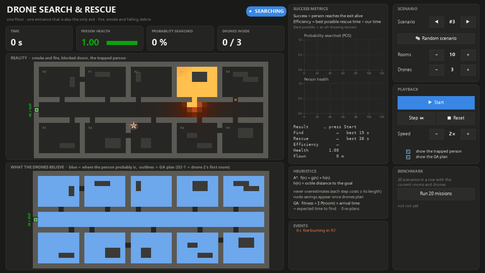

# Drone search and rescue in a burning building: Fuzzy A*, Bayesian search and GA allocation



**Task.** K drones enter a single-floor building with N rooms through **one door, which is also the only way out**.
One person is somewhere inside at a random spot. The person is unconscious and doesn't move, but loses health in smoke.
The drones must **find the person and lead them back out through that door**. Meanwhile the fire spreads, smoke
diffuses, and doors and corridor sections get blocked by debris. The drones know the floor plan, but not the fire,
the blockages or where the person is. A short-range noisy sensor is all they have, and they decide every simulated second
(1 tick = 1 s).

## Soft-computing methods and the job each one does

| Method | Where | Job |
|---|---|---|
| **Bayesian inference** | `navsim/belief.py` | A shared **P(person) map** over every free cell. Each look that finds nobody multiplies the cell's probability by (1 − p_detect), and p_detect falls with distance and smoke (Bayesian search theory), so areas missed in smoke keep part of their probability and get searched again. Also a **binary Bayes filter (log-odds) for P(blocked)** per cell. Its predict step is the world's transition model: a door can become blocked, more likely in smoke, but never clears. Bumping into a blockage is a certain observation, so it stays at P = 1. And a **1-D Kalman filter** for smoke per cell, whose variance grows while a cell goes unseen. |
| **Fuzzy A\*** | `navsim/fuzzy.py`, `navsim/astar.py` | A **Mamdani FIS** (4 inputs: hazard, P(blocked), uncertainty, resilience; 20 rules; centroid defuzzification) turns the belief into a per-cell traversal cost, and **A\*** plans on it every few ticks. Drones tolerate smoke but avoid doors that are probably blocked. The civilian being led out (resilience = 0.5 × health) gets much more smoke-averse routes. For real-time use the FIS is compiled into a 4-D lookup table (41×41×11×11) that is interpolated in under 1 ms. |
| **Genetic algorithm** | `navsim/ga.py` | Decides **which areas each drone searches and in what order** (a multiple-TSP). Chromosome = a permutation of areas plus K−1 delimiters. Fitness = **expected time to find the person**, Σ P(area) × arrival time, evaluated for the whole population at once with numpy. It uses order crossover, inversion and swap mutation, tournament selection and elitism, and re-runs (warm-started) when the belief changes. |

## Mission loop (`navsim/mission.py`)

Each tick:

1. The world evolves.
2. Every drone senses.
3. The shared belief is updated.
4. The fuzzy cost grid is rebuilt.
5. Areas are reallocated by the GA when needed: periodically, when a door's believed state flips, or when a drone runs out of areas.
6. Each drone picks a goal and moves one cell. If it runs into a blockage it didn't know about, it bumps and the belief is corrected.

On detection, the nearest drone flies to the person and leads them back to the entrance, planning with the person's own
resilience. The other drones leave.

## Ablation (leave one out)

| id | planner | belief | allocation |
|---|---|---|---|
| `FULL` | Fuzzy A\* | Bayes | GA |
| `noFuzzy` | plain A\* (distance) | Bayes | GA |
| `noBayes` | Fuzzy A\* | last reading only + coverage search | GA |
| `noGA` | Fuzzy A\* | Bayes | greedy P / cost |
| `B0` | plain A\* | last reading only + coverage search | nearest area first |

The coverage-search baseline is not a straw man. It goes to every cell of an area until 95% of the area has been
looked at, and it re-sweeps the whole building if the person is still missing. What it lacks is any memory that
a glance through smoke might have missed someone.

## Run it

```
py -3.11 -m venv .venv
.venv\Scripts\pip install -r requirements.txt
.venv\Scripts\python demo.py                         # the presentation app (add --fullscreen for full screen)
.venv\Scripts\python selftest.py                     # 13 sanity checks
.venv\Scripts\python experiments.py --jobs 8         # E1-E3 -> results/*.csv (about 10 min on 8 cores)
.venv\Scripts\python figures.py                      # figs/*.png + results/tables.md
.venv\Scripts\python demo.py --seed 3 --save figs/demo_seed3.gif    # record a run
```

**The presentation app** (`demo.py`) is a dark "mission control" window:
- **Top:** a phase indicator (searching → person found → escorting out → rescued / lost) and live tiles for time,
  person health, drones inside, GA re-plans and decision time per tick.
- **Middle:** *Reality* shows the smoke and fire, the true blockages and the trapped person.
- **Bottom:** *What the drones believe* shows the Bayesian probability map, the GA route of each drone (dashed) and its
  A\* path (solid).
- **Right-hand panel:**
  - **Rooms** (4-20) and **Drones** (1-8) sliders.
  - **Seed** box and **New scenario** button.
  - **Method** buttons to rerun the same fire without fuzzy, Bayes or GA.
  - **Start/Pause**, **Step**, **Stop/reset** and a **Speed** slider.
  - Toggles to hide the trapped person (for suspense) or the routes.
  - A live **event feed**: fire spreading, blocked doors found, GA re-plans, person found, rescued.
- **Keys:** space start/pause · → step · r reset · n new scenario · f full screen.

## Files

```
demo.py              the presentation app (and GIF recorder)
navsim/config.py     every constant; METHODS = the ablation table
navsim/building.py   floor plan generator: corridor, N rooms, doors, furniture, one entrance/exit, search areas
navsim/world.py      ground truth: fire spread, smoke diffusion, debris, person health
navsim/sensor.py     line-of-sight sensor: noisy blockage/smoke readings, distance- and smoke-dependent detection
navsim/belief.py     Bayesian belief (search map, log-odds, Kalman) and the raw-reading baseline
navsim/fuzzy.py      Mamdani FIS from scratch + compiled lookup table + cost grid
navsim/astar.py      8-connected A* (multi-goal) and Dijkstra
navsim/ga.py         GA allocation, greedy baselines, vectorised fitness
navsim/mission.py    the real-time loop and the drone state machine
navsim/render.py     map drawing (light theme for figures, dark theme for the app)
```

## Results

Full tables are in `results/tables.md`, figures in `figs/`. Test seeds 100-199, 10 rooms, 3 drones, 95% bootstrap CIs.

| | rescued alive | time to find* | time to rescue* | civilian smoke dose during escort* |
|---|---|---|---|---|
| **FULL** (Fuzzy A\* + Bayes + GA) | 73% | 39 s | 66 s | 0.33 |
| without fuzzy | 75% | 37 s | 64 s | 0.38 |
| without Bayes | 66% | 54 s | 95 s | 1.28 |
| without GA | 72% | 43 s | 69 s | 0.41 |
| B0 (none of the three) | 62% | 62 s | 106 s | 0.95 |

\* mean over the 59 seeds that every method rescued.

Paired comparison with FULL on the same seeds (other minus FULL, 95% bootstrap CI; a CI that excludes 0 is a clear effect):

| removed | only FULL rescued / only the other | McNemar p | extra time to find | extra escort smoke dose |
|---|---|---|---|---|
| fuzzy | 0 / 2 | 0.50 | −2.1 s [−5.9, 1.2] | **+0.115 [0.033, 0.224]** |
| Bayes | **8 / 1** | **0.04** | **+14.2 s [5.6, 23.4]** | **+0.888 [0.098, 2.311]** |
| GA | 2 / 1 | 1.00 | **+6.5 s [1.0, 12.2]** | **+0.222 [0.032, 0.494]** |
| all three | **11 / 0** | **<0.01** | **+20.9 s [9.8, 33.5]** | **+0.925 [0.275, 1.785]** |

What the data supports:
- **Bayes matters most.** It is the only method that measurably saves more lives: 8 people rescued that the
  version without Bayes loses, against 1 the other way round (p = 0.04). It also finds the person 14 s sooner. A single glance
  through smoke can miss someone, and only the Bayesian map keeps that possibility alive and sends drones back.
- **The GA speeds up the search.** Finds come 6.5 s sooner than with greedy allocation (CI excludes 0). On the allocation problems
  the team faces at t = 30 s, the GA beats greedy in **92-97% of cases, by 11-13%** in expected find time (random allocation is
  +160-180% worse). It gets within 1% of its final result in about 45 generations (10 rooms, 3 drones) to 85 (16 rooms,
  6 drones), in 190-310 ms.
- **Fuzzy A\* protects the civilian on the way out.** Their smoke dose during the escort is significantly lower without
  significantly slowing the search. It doesn't change the number of rescues (0 vs 2 discordant seeds, p = 0.5).
- **Scaling (fig 6):** in 10 rooms, going from 1 to 3 drones cuts the time to find from 84 s to 43 s and raises rescues from
  56% to 68%. More drones keep helping, with diminishing returns.
- **Real time (fig 7):** the 95th-percentile decision time per tick stays under 300 ms even with 16 rooms and 6 drones,
  well inside the 1 s tick.
- 25 of the 100 scenarios are lost by every method. In those, the fire cuts the person off or overcomes them before anyone can
  reach them; with a single way out this happens more often than with three exits.

| Figure | Shows |
|---|---|
| `figs/fig1_mission.png` | one mission: entry, find, rescue (seed picked by a fixed rule: the first test seed found after >= 30 s) |
| `figs/fig2_fuzzy.png` | membership functions and the penalty surfaces for a drone vs the civilian |
| `figs/fig3_bayes.png` | the Bayesian P(person) map draining as the drones search |
| `figs/fig4_ablation.png` | leave-one-out ablation |
| `figs/fig5_ga.png` | GA convergence and GA vs greedy vs random |
| `figs/fig6_scaling.png` | 1-6 drones in 6, 10 and 16 rooms |
| `figs/fig7_realtime.png` | decision time per tick against the 1 s budget |
| `figs/demo_seed3.gif` | the presentation app, recorded |

## Calibration and honesty notes

- The fire, debris and health constants and the fuzzy rule base were tuned on **seeds 0-39**. All reported experiments
  use **seeds 100 and up**.
- The building was first built with three exits. It now has a single door used both to enter and to leave, and **all
  results above come from that layout**. With three exits, Bayes was still clearly helpful, but the GA's and fuzzy's
  end-to-end effects were not significant.
- The first fuzzy rule base made drones avoid smoke as strongly as a civilian would. That made them detour around the
  corridor where the person was, and it lost rescues. The rules were redesigned so that drones tolerate smoke and the civilian does
  not.
- A first version let the blockage belief drift back to its prior. Drones then forgot doors they knew were blocked and
  walked into them about 11 times per mission. It was replaced by the correct absorbing transition model.
- Simplifications: a 2-D single floor, a 0.5 m grid, perfect communication between drones, a stationary person, and a
  smoke/heat field reduced to one hazard value per cell.
