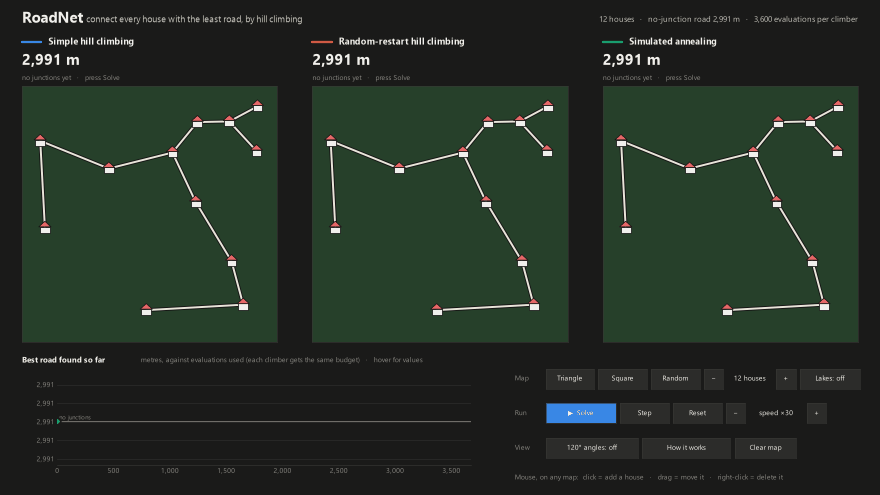
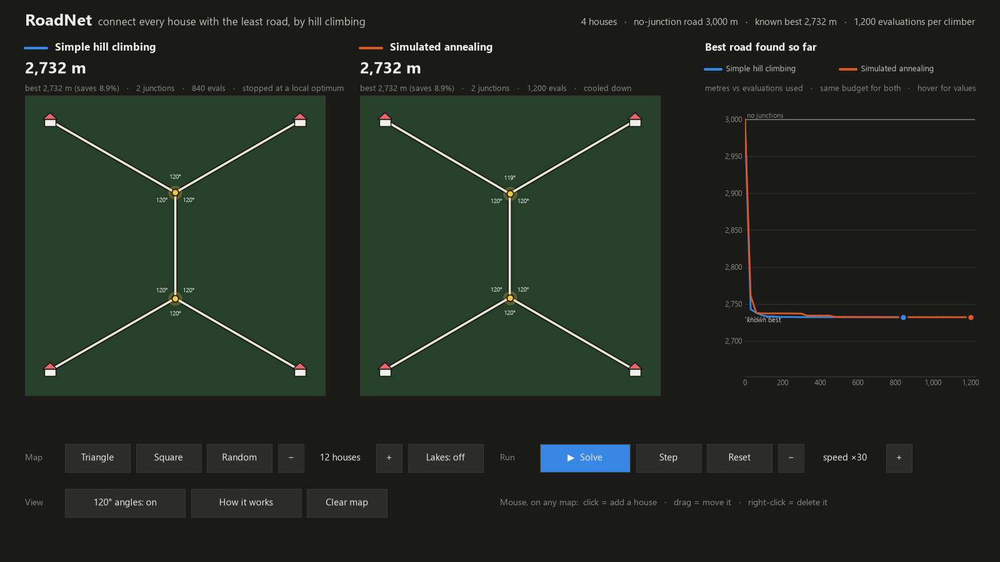
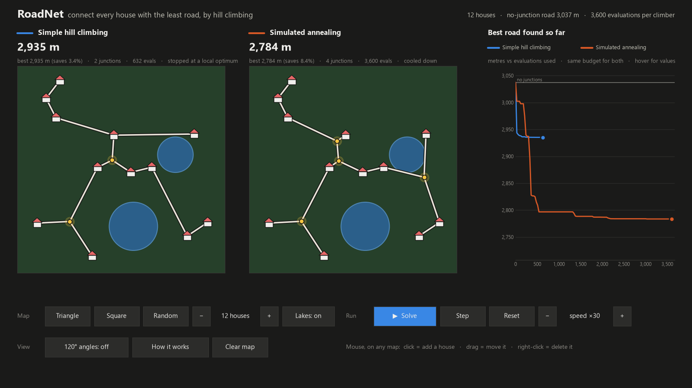

# RoadNet: connect every house with the least road, by hill climbing



Some houses are scattered over a 1.2 km × 1.2 km area, and all of them must be connected by road. Every metre of road
costs money, and a metre built across a lake costs **3×**. Roads may meet at **junctions**, extra points that are not
houses. Junctions can shorten the network a lot: four houses on the corners of a square need 3,000 m of road without
junctions, 2,828 m with one junction in the middle (an X), and only **2,732 m** with two junctions (an H).

Where should the junctions go? This is the **Euclidean Steiner tree problem**, which is NP-hard, so instead of trying
every possibility RoadNet **searches** for good junction positions. Two methods race side by side on the same map,
with the same budget: **simple hill climbing** and **simulated annealing**.

## The search problem

| | |
|---|---|
| **State** | the positions of the junctions (at most N − 2 for N houses, which is all a Steiner tree ever needs) |
| **Cost** | total road of the cheapest network that joins the houses and junctions: the **minimum spanning tree** (Prim's algorithm) over them, where a straight road costs its length plus 2 × the part of it inside a lake |
| **Start** | no junctions: the spanning tree over the houses alone. This is the **baseline without search**. |
| **Moves** (neighbours) | **nudge** a junction by a random step · **add** a junction in the middle of a "V" (a node and two of its road neighbours) · **remove** a junction. Dead-end junctions are dropped automatically, because they only add road. |
| **Goal** | lowest cost |

Why the spanning tree? Once the junction positions are fixed, the cheapest way to join a set of points with straight
roads is their minimum spanning tree. The search therefore only has to decide where the junctions go.

## The two climbers

Both start from the baseline and get the same number of cost evaluations (300 × N), so the race is fair.

1. **Simple hill climbing.** Try a random move and keep it only if the road gets shorter. After 60 failed tries in a
   row the nudge size halves (60 m → 30 m → … ). When it drops below 1 m, no small change helps any more: the climber
   is at a **local optimum** and stops, even if budget is left.
2. **Simulated annealing.** The same moves, but a longer road is also accepted, with probability e^(−Δ/T). The
   temperature T starts at 5% of the average road per house and cools geometrically to 1/1000 of that, and the nudge
   size shrinks with √T. Early on it can climb out of a local optimum; by the end it behaves like plain hill climbing.
   It keeps the best network it has seen.

## How we know it works

* **Triangle.** For three houses on an equilateral triangle, the best network is known exactly: one junction in the
  centre, with three roads meeting at 120°, for √3 × side = 1,732 m. That is 13.4% less than the 2,000 m baseline.
  Both climbers find it.
* **Square.** Both climbers find the H (2,732 m), not the X (2,828 m), and every junction angle is within 1° of 120°.
* **The 120° rule.** In a shortest network on flat land, roads always meet at junctions at 120°. Press
  "120° angles" in the app to see the junctions settle there.
* **Upper bound.** On flat land, junctions save at most about 13.4% over the no-junction network (the Steiner ratio
  √3/2). Savings close to that are only possible for special layouts like the triangle.



`selftest.py` checks all of this (14 checks), plus:
- the lake cost of a road (through the middle of a lake, beside it, entirely inside it);
- the spanning tree on a hand-worked example;
- both climbers are never worse than the baseline, on 20 random maps;
- a fixed seed always gives the same result.

`tests_ui.py` clicks every button, presses every key, adds, drags and deletes houses, runs a full race and measures the
frame time (27 checks).

## Results

Measured with the app's settings (same climber seed as the app). Each row can be reproduced with the command shown. In
each cell: road length · % saved vs no junctions · junctions · evaluations used.

| Map (command) | No junctions | Simple hill climbing | Simulated annealing |
|---|---|---|---|
| Triangle (`--preset triangle`) | 2,000 m | 1,732 m · 13.4% · 1 · 362 | 1,732 m · 13.4% · 1 · 900 |
| Square (`--preset square`) | 3,000 m | 2,732 m · 8.9% · 2 · 840 | 2,732 m · 8.9% · 2 · 1,200 |
| 12 houses (default map, seed 17) | 2,920 m | 2,890 m · 1.0% · 1 · 529 | **2,832 m · 3.0%** · 4 · 3,600 |
| 12 houses + lakes (`--seed 11 --lakes`) | 3,037 m | 2,935 m · 3.4% · 2 · 632 | **2,784 m · 8.4%** · 4 · 3,600 |
| Square + lakes (`--preset square --lakes --seed 0`) | 3,000 m | 3,000 m · 0% · 0 · 533 | 3,000 m · 0% · 0 · 1,200 |

What this shows:

* **Simple hill climbing stops early at a local optimum.** On the default map it stops after 529 of its 3,600
  evaluations, at 1.0% saved. Annealing accepts some longer roads on the way, keeps going, and saves 3.0%.
* **With lakes the gap is often larger**, here 3.4% vs 8.4%. A good route around a lake usually needs junctions that
  first make the road longer, which simple hill climbing never accepts.
* **Annealing is not magic.** On the square with lakes, the lakes sit where the junctions would go. The cheapest
  junction the *add* move can place makes the road 624 m longer. Simple hill climbing refuses that step, and at
  annealing's starting temperature (T = 37.5) it is accepted with probability e^(−624/37.5) ≈ 10⁻⁷. So both stay at
  the no-junction network, although a single junction threading between the lakes would save about 4%.
* On many random maps both climbers find the same network (for example `--seed 3` or `--seed 4`). The local optima
  matter on some maps, not on every map.



## Run it

```
py -3.11 -m venv .venv
.venv\Scripts\python -m pip install -r requirements.txt
.venv\Scripts\python demo.py
```

| Control | What it does |
|---|---|
| **Map:** Triangle · Square · Random · − / + houses · Lakes | load a preset, a new random map, change the number of houses (3–20), add or remove lakes |
| **Run:** Solve · Step · Reset · − / + speed | start or pause the race, advance one evaluation, start the race again, evaluations per frame |
| **View:** 120° angles · How it works · Clear map | label the junction angles, open the explanation panel, remove all houses |
| **Mouse** on either map | click to add a house, drag to move it, right-click to delete it |
| **Keys** | space solve/pause · → step · r reset · n new random map · l lakes · a angles · i how it works · + / − speed |
| **Chart** | hover to read each climber's best road at that point |

Command line: `--preset triangle|square|random`, `--houses N`, `--seed S`, `--lakes`, `--angles`, `--fullscreen`,
`--save picture.png` or `--save race.gif` (runs without a window).

```
.venv\Scripts\python selftest.py     # 14 checks of the maths and the climbers
.venv\Scripts\python tests_ui.py     # 27 checks of the app
```

## Files

| File | Contents |
|---|---|
| `roadnet/world.py` | the map: houses, lakes, presets, seeded random maps |
| `roadnet/network.py` | road cost of a straight segment (lake crossings solved exactly), minimum spanning tree, baseline, junction angles |
| `roadnet/climb.py` | the moves and the two climbers (each a generator, so the app can animate it step by step) |
| `roadnet/draw.py` | drawing a map: land, lakes, houses, roads, junctions, angle labels |
| `demo.py` | the app (only the moving parts are redrawn each frame, so it animates smoothly) |
| `selftest.py`, `tests_ui.py` | the checks |
